  

I recently finished my MS in Computer Science at UNT. I build LLM systems and the backend plumbing under them, and I care most about what happens when they are wrong: every answer should point at its source, every number should come with the file that produced it, and the misses go in the README next to the wins.

  

Every number above links back to a repo below. Latency and throughput figures are loopback on one machine, and the repos say so.

---

## Start here

- **[EvalForge](https://github.com/vamsi513/evalforge)** · [live demo](https://evalforge-platform.vercel.app) — an LLM evaluation platform with swappable judges, and the agreement numbers to show they agree.
- **[AgentIQ](https://github.com/vamsi513/agentiq)** · [live demo](https://agentiq-platform.vercel.app) — a research agent that routes between retrieval and web search, with run budgets and an audit log of every tool call.
- **[Deal Notes Graph](https://github.com/vamsi513/deal-notes-graph)** · [live demo](https://deal-notes-graph.vercel.app) — a GraphQL service that pulls CRM fields out of sales notes and shows the sentence each one came from.

---

## Where I published the misses

A result is easier to trust when the author shows where it failed. These are mine.

| Project | What I expected | What the measurement said |
|---|---|---|
| [triagetune](https://github.com/vamsi513/triagetune) | A fine tuned model would beat the classic baseline | LoRA took a 1.5B model from 30.2% to 80.5% accuracy and removed invalid JSON, but a TF-IDF plus logistic regression baseline still scored about 4 points higher. I reported it with bootstrap confidence intervals. |
| [netlog-anomaly](https://github.com/vamsi513/netlog-anomaly) | Learned models would find the anomalies | A plain severity rule (F1 0.759) beat a z score (0.392) and an Isolation Forest (0.152) on the time split. |
| [deal-notes-graph](https://github.com/vamsi513/deal-notes-graph) | Tune the extractor until the score is perfect | I did not tune against my own answer key. All three failing cases are published, field by field. |
| [incident-memory-ai](https://github.com/vamsi513/incident-memory-ai) | Hybrid search would beat dense only | Their rankings differ on 10 of 60 queries, five each way, and the swings nearly cancel. Reranking is what actually wins. |
| [evalforge](https://github.com/vamsi513/evalforge) | The LLM judge was scoring cases | A rejected schema made it silently fall back to a mock judge. I found it, fixed it, and pinned it with a regression test. |

---

## Retrieval, extraction and agents

| Project | What it does | Proof |
|---|---|---|
| [**AgentIQ**](https://github.com/vamsi513/agentiq) · [live demo](https://agentiq-platform.vercel.app) | Research assistant that routes between retrieval and live web search, with run budgets and a tool call audit log | 297 tests. Autoscaled 1 to 4 replicas on Kubernetes across about 1,371 requests. This was observed live on a temporary OpenShift sandbox and is not reproducible from anything in this repo. |
| [**EvalForge**](https://github.com/vamsi513/evalforge) · [live demo](https://evalforge-platform.vercel.app) | LLM evaluation platform with pluggable judges: OpenAI, Anthropic, and a self hosted Ollama model | 60 hand written cases, 93.3% agreement, kappa 0.859 versus OpenAI. |
| [**Deal Notes Graph**](https://github.com/vamsi513/deal-notes-graph) · [live demo](https://deal-notes-graph.vercel.app) | GraphQL service that pulls five CRM fields out of sales notes with a deterministic rule based extractor, and shows each fact beside the sentence it was quoted from | 0.993 precision, 0.986 recall over 143 facts. The demo needs no database and no keys. |
| [**Rental FAQ Voice Assistant**](https://github.com/vamsi513/rental-faq-voice-assistant) | Voice assistant that answers only from a policy corpus, refuses off topic requests, and posts a ticket only after an explicit yes | Hit@3 0.98 and MRR 0.935 on 57 questions. 265 Python and 15 TypeScript tests. |
| [**Note Grounding Check**](https://github.com/vamsi513/note-grounding-check) | Checks each sentence of a generated clinical style note against the visit conversation with a deterministic rule based checker, no model involved, and flags claims the source does not support. A reliability study on synthetic data I wrote, not clinical software | 72 tests. Precision 0.909, recall 1.000 over 30 notes. A lexical overlap baseline caught only 5 of 10 unsupported sentences. |
| [**IncidentMemory AI**](https://github.com/vamsi513/incident-memory-ai) · [live dashboard](https://incidentmemory-platformvercelapp.vercel.app) | Hybrid BM25, dense, and cross encoder search over incident reports | 60 labeled queries, Hit@3 0.95, MRR 0.867, p95 retrieval 79.6 ms. |
| [**TriageTune**](https://github.com/vamsi513/triagetune) | LoRA fine tune of Qwen2.5 1.5B for structured JSON intent classification | See the table above. |
| [**MCP Tool Agent**](https://github.com/vamsi513/mcp-tool-agent) | A real MCP server with three tools, and a CLI agent that discovers and calls them | Exposes GitHub search, URL fetch, and a SQLite query over stdio JSON-RPC. |

## Backend and systems

| Project | What it does | Proof |
|---|---|---|
| [**Installment Ledger**](https://github.com/vamsi513/installment-ledger) · [load test](https://github.com/vamsi513/ledger-loadtest) | Loan and payments API: integer cents, a double entry ledger enforced by a database trigger, idempotency keys, row locking | 256 tests on real Postgres, including concurrent payments sharing one key. |
| [**Device Control Demo**](https://github.com/vamsi513/device-control-demo) | MQTT commands to simulated devices with acks, retries, and duplicate handling | 75 tests against a real broker. |
| [**kvnet**](https://github.com/vamsi513/kvnet) | Single threaded C++17 key value server over TCP, epoll and kqueue | 29 protocol assertions, 13 socket tests, ASan and UBSan builds. |
| [**Netlog Anomaly**](https://github.com/vamsi513/netlog-anomaly) | SQL and Python pipeline over 4.7 million public log lines, with an Airflow DAG | 169 tests. Idempotent loads, bad lines quarantined. |

---

## Research

Coauthor of **[Cross Lingual Stability and Bias in Instruction Tuned Language Models for Humanitarian NLP](https://lrec.elra.info/lrec2026-main-346)**, LREC 2026. We ran 78,000 inferences across six models and seven languages and introduced four measures of cross lingual reliability. The finding that stuck with me: alignment, not model size, decided how stable a model was across languages.

## Toolbox

**Languages** Python, TypeScript, JavaScript, SQL, C++
**LLM systems** LangGraph, LangChain, RAG, FAISS, BM25, cross encoder reranking, tool calling, MCP, LLM judge evaluation
**Backend** FastAPI, Node.js, GraphQL (Apollo), PostgreSQL, Redis, SQLAlchemy, WebSockets, MQTT
**Frontend** React, Next.js
**Infrastructure** Docker, Kubernetes, AWS, Terraform, GitHub Actions, OpenTelemetry, Grafana, pytest

## Say hello

I am looking for AI and software engineering roles where I can build systems end to end and keep measuring them.

[LinkedIn](https://www.linkedin.com/in/vamsi-krishna-s-350b98258) · [Email](mailto:saduvamsikrishna513@gmail.com)

If a number on this page looks too good, the repo it links to has the file that produced it.
